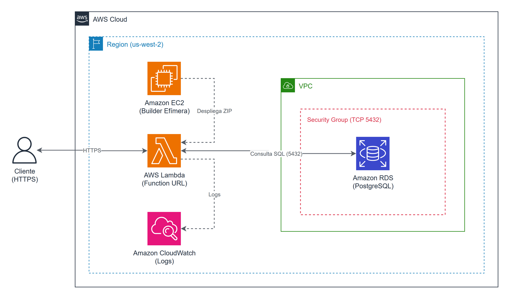
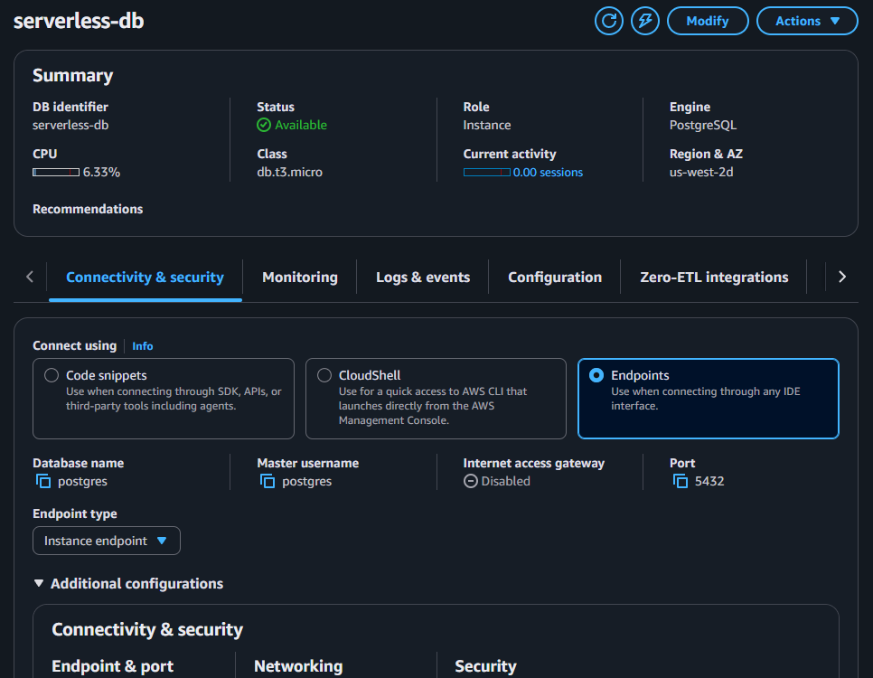
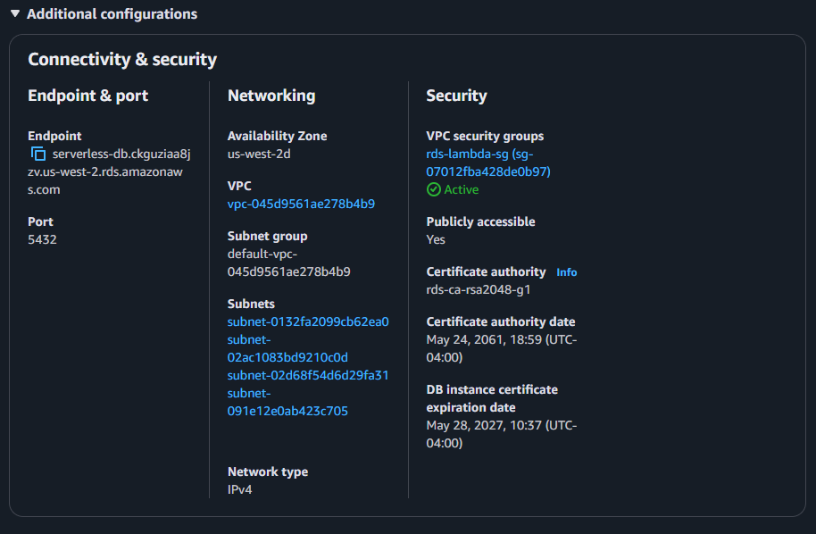
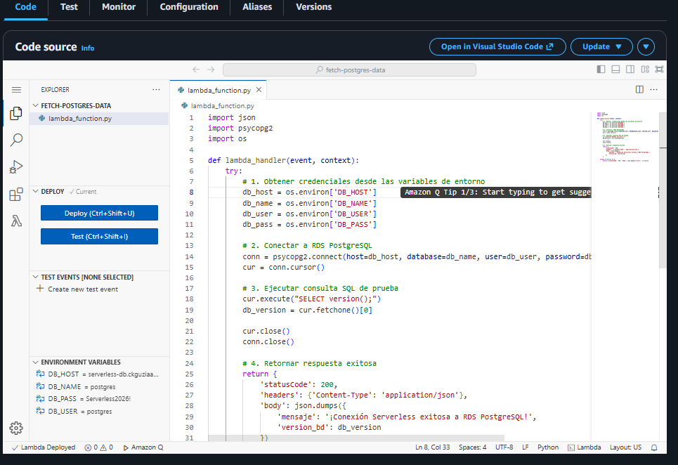
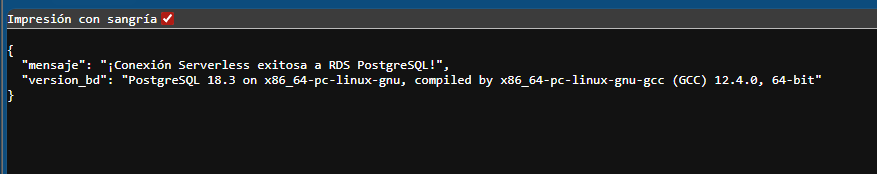
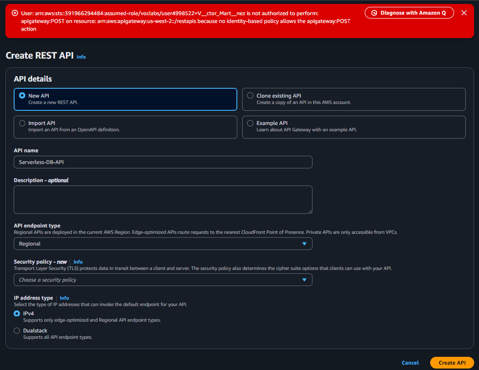
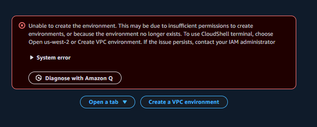
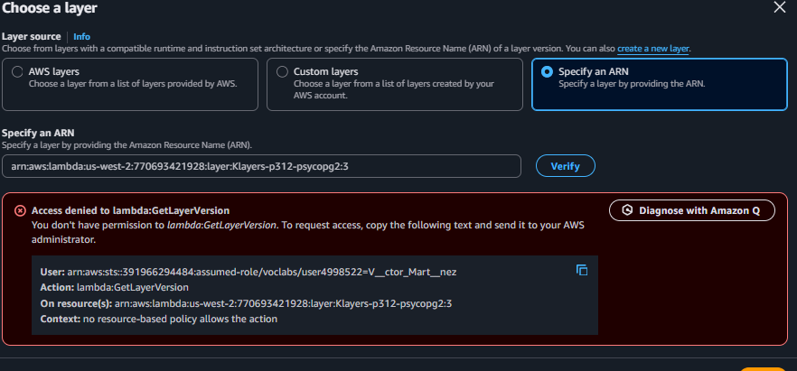
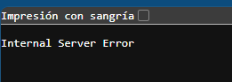
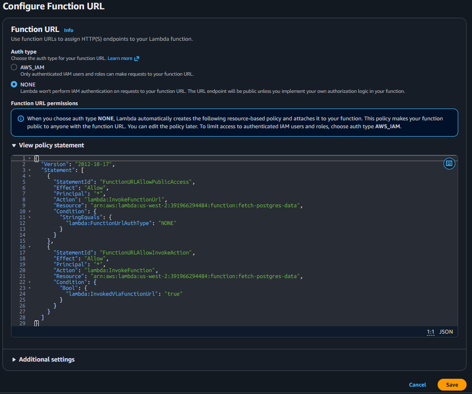

# AWS Serverless Postgres API — Arquitectura Adaptativa y Troubleshooting IAM

[](https://aws.amazon.com/)
[](https://www.python.org/)
[](https://aws.amazon.com/rds/postgresql/)
[](scripts/ec2_user_data.sh)

> Despliegue y troubleshooting real de una API serverless en AWS (**Lambda Python 3.11** + **Amazon RDS PostgreSQL**) dentro de un entorno con políticas IAM acotadas, utilizando alternativas nativas autorizadas (**Lambda Function URL** y empaquetado efímero en **EC2**).

---

## Contexto y Problema

Al desplegar un backend serverless conectado a **Amazon RDS (PostgreSQL)** en un entorno sandbox con políticas IAM estrictas, el flujo estándar encontró tres bloqueos operativos:
- Denegación de permisos para crear APIs en **Amazon API Gateway** (`apigateway:POST` denied).
- Bloqueo de **AWS CloudShell** y de **Lambda Layers** externas.
- Error `Runtime.ImportModuleError` en ejecución por incompatibilidad de binarios compilados de `psycopg2` (generados para Python 3.9 en lugar de Python 3.11).

Este repositorio documenta la arquitectura resultante, los scripts de automatización y la evidencia real de diagnóstico y resolución.

---

## Arquitectura del Sistema

Flujo completo de exposición HTTPS, consulta a RDS dentro de VPC y build efímero en EC2 (`us-west-2`):



### Flujo de Trabajo y Rol de cada Servicio

1. **Empaquetado efímero (`Amazon EC2 Builder`):** Ante restricciones IAM sobre CloudShell y Lambda Layers, se levanta una instancia EC2 temporal con un script Bash en User Data que instala Python 3.11, empaqueta `psycopg2-binary` junto al código de la función y actualiza Lambda vía AWS CLI. Al terminar, la instancia se elimina.
2. **Exposición HTTPS (`AWS Lambda` + `Function URL`):** El cliente realiza peticiones HTTPS directamente a la Function URL nativa de Lambda (reemplazando a API Gateway debido al bloqueo IAM), sin servidores intermedios.
3. **Acceso a base de datos (`VPC` + `Security Group` + `Amazon RDS`):** Lambda lee las credenciales desde variables de entorno y se conecta por `TCP 5432` (autorizado en el Security Group) a Amazon RDS PostgreSQL dentro de la VPC para ejecutar la consulta y devolver la respuesta JSON.
4. **Diagnóstico y logs (`Amazon CloudWatch`):** Cada ejecución registra sus eventos y trazas de error en CloudWatch Logs, lo que permitió diagnosticar el error `Runtime.ImportModuleError` y validar la corrección.

---

## Decisiones Técnicas y Troubleshooting

1. **Lambda Function URL en lugar de API Gateway:** ante la restricción de permisos en API Gateway, se expuso `fetch-postgres-data` mediante una **Lambda Function URL** nativa HTTPS, evitando componentes intermedios y reduciendo latencia y costo por solicitud.
2. **Empaquetado efímero en EC2 Amazon Linux (`scripts/ec2_user_data.sh`):** para resolver `Runtime.ImportModuleError` sin CloudShell ni Layers externas, se levantó una instancia EC2 temporal con un script de User Data que instala `python3.11`, empaqueta `psycopg2-binary` junto a [src/lambda_function.py](src/lambda_function.py) en un ZIP compatible con el runtime de Lambda y ejecuta `aws lambda update-function-code`. Finalizado el despliegue, la instancia se destruyó.
3. **Cierre explícito de conexiones SQL:** la función cierra cursor y conexión (`cur.close()`, `conn.close()`) en cada invocación para evitar fugas de conexiones hacia `db.t3.micro`.

---

## Seguridad e IAM

Controles aplicados en el despliegue actual:
- **Sin credenciales en el código fuente:** `DB_HOST`, `DB_NAME`, `DB_USER` y `DB_PASS` se inyectan mediante variables de entorno de AWS Lambda.
- **Control perimetral de red:** el **Security Group** de Amazon RDS expone únicamente el puerto `TCP 5432` para tráfico PostgreSQL.
- **Superficie de ataque efímera:** la instancia EC2 usada como builder se elimina inmediatamente tras actualizar el paquete de Lambda.

**Hardening previsto para producción:**
- Migrar credenciales de variables de entorno a **AWS Secrets Manager** con rotación automática.
- Ubicar tanto Lambda como RDS en **subredes privadas** con reglas Security Group a Security Group, e incorporar **Amazon RDS Proxy** para manejar pooling de conexiones bajo concurrencia alta.
- Cambiar la autenticación de la Function URL de `NONE` a `AWS_IAM` (o exponer detrás de API Gateway + Cognito) y restringir `Access-Control-Allow-Origin: '*'` al dominio del cliente.

---

## FinOps y Control de Costos

- **AWS Lambda + Function URL:** dentro del AWS Free Tier (1M solicitudes/mes) y sin costo adicional por request de API Gateway.
- **EC2 Builder efímera:** ejecutada pocos minutos solo durante el empaquetado y terminada al completar el despliegue (costo marginal ~$0.00).
- **Amazon RDS (`db.t3.micro`, Single-AZ):** cubierta por las 750 horas/mes del Free Tier de RDS durante el primer año; en entornos de laboratorio se recomienda detener o eliminar la instancia al finalizar las pruebas para evitar cargos residuales.

---

## Evidencia de Despliegue y Troubleshooting

### 1. Base de datos RDS desplegada (Endpoint y Security Group TCP 5432)



### 2. Inyección de credenciales vía Variables de Entorno en Lambda


### 3. Validación final desde Function URL (HTTP 200 + versión PostgreSQL)


### Galería de errores diagnosticados y resolución

<details>
<summary><b>Error 1: Denegación de permisos en Amazon API Gateway</b></summary>

Bloqueo `apigateway:POST` al intentar crear una REST API (`assets/err_apigateway.png`).

</details>

<details>
<summary><b>Error 2: Bloqueo de AWS CloudShell</b></summary>

Denegación al iniciar CloudShell en consola (`assets/err_cloudshell.png`).

</details>

<details>
<summary><b>Error 3: Bloqueo de Lambda Layers externas</b></summary>

Restricción al adjuntar una capa ARN pública (`assets/err_lambda_layer.png`).

</details>

<details>
<summary><b>Error 4: Runtime.ImportModuleError (binarios psycopg2 incompatibles)</b></summary>

Error en CloudWatch Logs por compilar `psycopg2` en Python 3.9 frente a Lambda en Python 3.11 (`assets/err_internal_server.png`).

</details>

<details>
<summary><b>Resolución: Configuración de Lambda Function URL</b></summary>

Exposición HTTPS nativa mediante Function URL (`assets/sol_function_url.png`).

</details>

---

## Estructura del Repositorio

```text
aws-serverless-postgres-api/
├── assets/                    # Capturas reales de despliegue, errores IAM y validación
├── docs/
│   ├── architecture.drawio    # Fuente editable del diagrama (Draw.io / AWS4)
│   └── architecture.png       # Diagrama de arquitectura serverless y build efímero
├── scripts/
│   └── ec2_user_data.sh       # Script Bash para empaquetar psycopg2 (Py 3.11) y subir a Lambda
├── src/
│   └── lambda_function.py     # Handler Lambda con conexión a RDS PostgreSQL
└── README.md
```

---

## Autor

**Víctor Martínez** — Junior Cloud Engineer | AWS, FinOps & Applied AI  
AWS Certified Cloud Practitioner • AWS Cloud re/Start • En preparación para SAA-C03

- **Portafolio:** [vitonez5198.github.io/Portfolio-VM](https://vitonez5198.github.io/Portfolio-VM/)
- **LinkedIn:** [victor-ms-dev](https://www.linkedin.com/in/victor-ms-dev/)
- **GitHub:** [@VitoNez5198](https://github.com/VitoNez5198)
